# Evaluación de la modal de Configuración: UX y UI

**Fecha:** 2026-11-06 · **Rama:** `ccr-dfd589ce-gjq30q` · **Estándar:** v0.1 (borrador; sus reglas se aplican como vigentes por instrucción expresa)

> **Reevaluación (2026-11-07).** Los 26 hallazgos están corregidos, y también los 8 defectos nuevos que encontró la reevaluación. Con el mismo estándar y la misma fórmula, la nota es **10 / 10**, con las 43 reglas verificadas (EST-02 y PERM-01 incluidas). Ver [la reevaluación](2026-11-REEVALUACION-MODAL-CONFIGURACION.md), con capturas de antes y después de cada hallazgo.

**Objeto.** La modal que se abre con `#settings/<página>`: su armazón (cabecera, barra lateral, buscador, guardado, foco) y las **25 páginas** que ve una empresa de República Dominicana. Las dos páginas que solo aparecen en otros países (Régimen de facturación electrónica; Jurisdicciones fiscales, solo EE. UU. y Brasil) quedan fuera.

**Método.** Aplicación servida en local con los datos del sembrado de desarrollo (empresa «Virtex Dev», DO, usuario administrador), recorrida con Chromium y Playwright. Mediciones del DOM, axe-core con las etiquetas WCAG 2.0/2.1/2.2 A y AA, y lectura del código solo donde un hallazgo necesitaba su causa.

**Condiciones.**
- Tema claro y oscuro.
- Densidad cómoda y compacta.
- Tres tamaños de pantalla: 1440 × 900, 1366 × 768 y 390 × 844 (modo compacto).
- 80 tabulaciones por página.
- Protección de cambios probada en 10 páginas.
- 13 búsquedas.

**Qué no se hizo.**
- No se simularon fallos de red (EST-02).
- No se probó con un usuario sin permisos (PERM-01).
- No se guardaron cambios de configuración ni se crearon registros.
- La empresa es nueva: listas como Sucursales o Retenciones se vieron vacías.

La evaluación es de solo lectura: no se modificó código de la aplicación.

**Evidencia.**
- Capturas en [`2026-11-modal-configuracion/capturas/`](2026-11-modal-configuracion/capturas/), tomadas a doble densidad, con el elemento señalado en rojo y numerado.
- Mediciones en [`resultados/`](2026-11-modal-configuracion/resultados/).
- Scripts reproducibles en [`harness/`](2026-11-modal-configuracion/harness/).

---

## Resumen

### Nota: **6,8 / 10** (definitiva)

| | |
|---|---|
| Cumplimiento ponderado | 68,1 % (72,9 de 107 puntos) |
| Cobertura | 41 de 43 reglas verificadas (95 %) |
| Tope por severidad | 7 (hay hallazgos altos; no recorta la nota) |
| Hallazgos | **4 altos · 12 medios · 10 bajos** |

**Fuerte: el armazón.** Las 25 páginas comparten la misma cabecera, la navegación y el buscador, y el diálogo es accesible: el foco no se escapó ni una vez en 2 000 tabulaciones.

**Débil: el interior de las páginas.** Cada página resuelve a su manera los títulos de grupo, los contenedores, los estados vacíos, el guardado y los colores de estado. Hay además dos caminos por los que se pierden cambios sin aviso (Correo saliente e Inteligencia artificial) y cuatro fallos de accesibilidad.

**Lo que más sube la nota.** De los 34 puntos perdidos, 22 son de **ocho reglas de consistencia global** que fallan:
- títulos de grupo;
- contenedor;
- radio;
- estado vacío;
- color de estado;
- patrones de componente;
- formato de moneda;
- modelo de guardado.

Unificarlas llevaría la nota a **≈ 8,9** sin tocar nada más. Los cuatro hallazgos altos pesan poco en puntos, pero mientras existan la nota no puede pasar de 7.

---

## Lo que funciona

1. **Un solo armazón.**
   - Todas las páginas tienen miga, título, descripción y alcance («Solo para ti», «Afecta a toda la empresa», «Administración»).
   - La página activa se marca en la barra lateral.
   - El buscador entiende palabras clave: «NCF» lleva a Comprobantes fiscales y Numeración, y «tema oscuro» lleva a Preferencias.
2. **Diálogo accesible.** Hubo 0 fugas de foco en 25 páginas × 80 tabulaciones. Escape cierra solo la capa de arriba: primero un desplegable o una confirmación, después la modal.
3. **Protección de cambios** en 8 de las 10 páginas probadas. La barra de guardado dice por qué no se puede guardar, y el aviso ofrece Cancelar, Descartar o Guardar.

   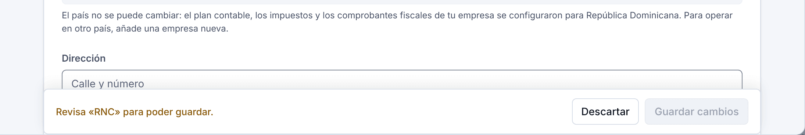
   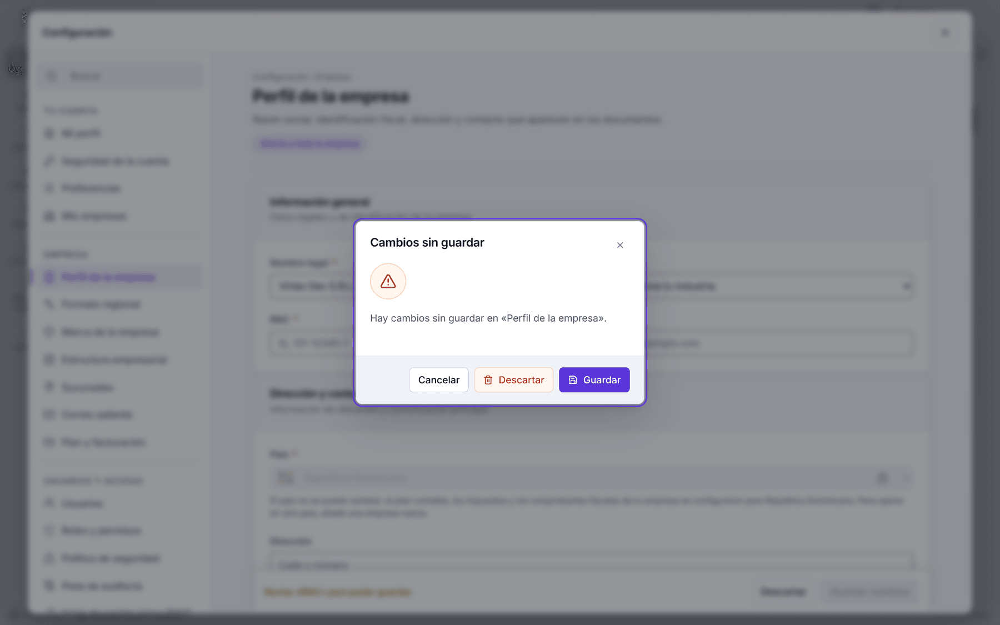
4. **Confirmación proporcional.**
   - Restablecer la marca pide confirmación y explica el alcance.
   - Cerrar las demás sesiones pide verificar la identidad.
   - Exigir segundo factor a todos pide confirmación.

   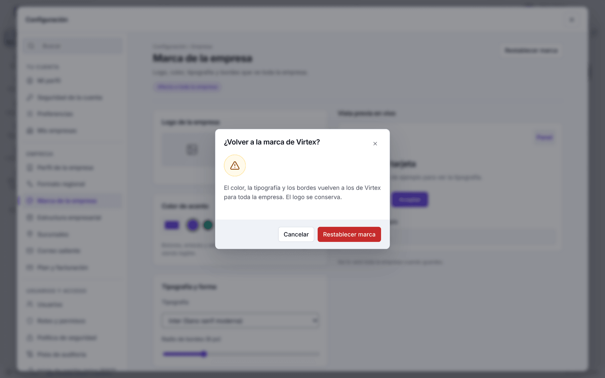
   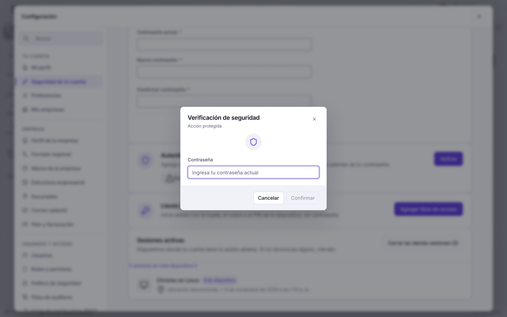
5. **Tema claro y tamaños táctiles.** axe no encontró fallos de contraste en el tema claro, y todos los objetivos miden al menos 24 px en ambas densidades (WCAG 2.5.8).
6. **Formatos y textos.**
   - Las fechas salen en el formato de la empresa (dd/mm/aaaa).
   - Varios textos explican consecuencias: el país bloqueado dice por qué, y Correo saliente avisa de que, sin dirección de respuesta, las respuestas de los clientes «no llegarán a nadie».
7. **Botones deshabilitados bien resueltos en Roles.** Editar y eliminar un rol del sistema siguen siendo enfocables (`aria-disabled`), y su nombre accesible explica el motivo: «Los roles del sistema no se editan ni se eliminan: duplícalo para adaptarlo». Es la forma correcta de COMP-02.

---

## Hallazgos

Ordenados por severidad. Cada uno cita la regla del estándar (definidas en la sección [Estándar v0.1](#estándar-v01-aplicado)).

### Altos

#### H01 · Correo saliente descarta los cambios sin avisar
**Regla:** GUA-01 (DEBE) · **Severidad:** alta · **Página:** Correo saliente

- **Qué pasa.** Escribí en «Nombre del remitente» y pulsé Escape: la modal se cerró sin preguntar, y al reabrir el campo estaba vacío. Con la X ocurre lo mismo. Es la única página con formulario que no pregunta: Mi perfil, Perfil de la empresa, Formato regional, Marca, Numeración y Políticas contables sí lo hacen.
- **Causa.** La página calcula su propio estado de cambios (`system/smtp/smtp.page.ts:72`), pero no lo registra en el servicio del armazón. Ese registro es lo que activa el aviso al cerrar.
- **Corrección.** Usar la barra de guardado común, o como mínimo registrar los cambios en el servicio del armazón.

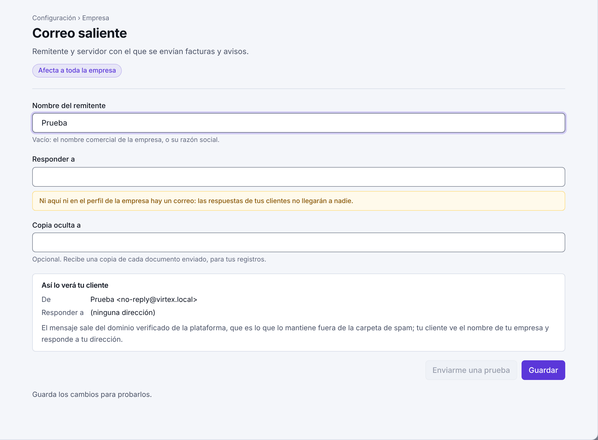
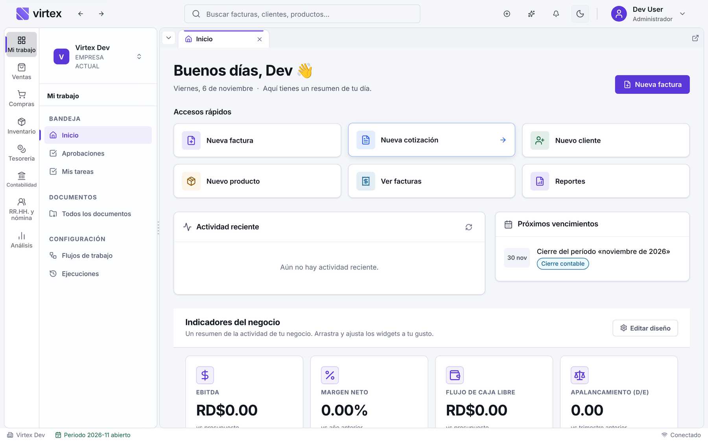
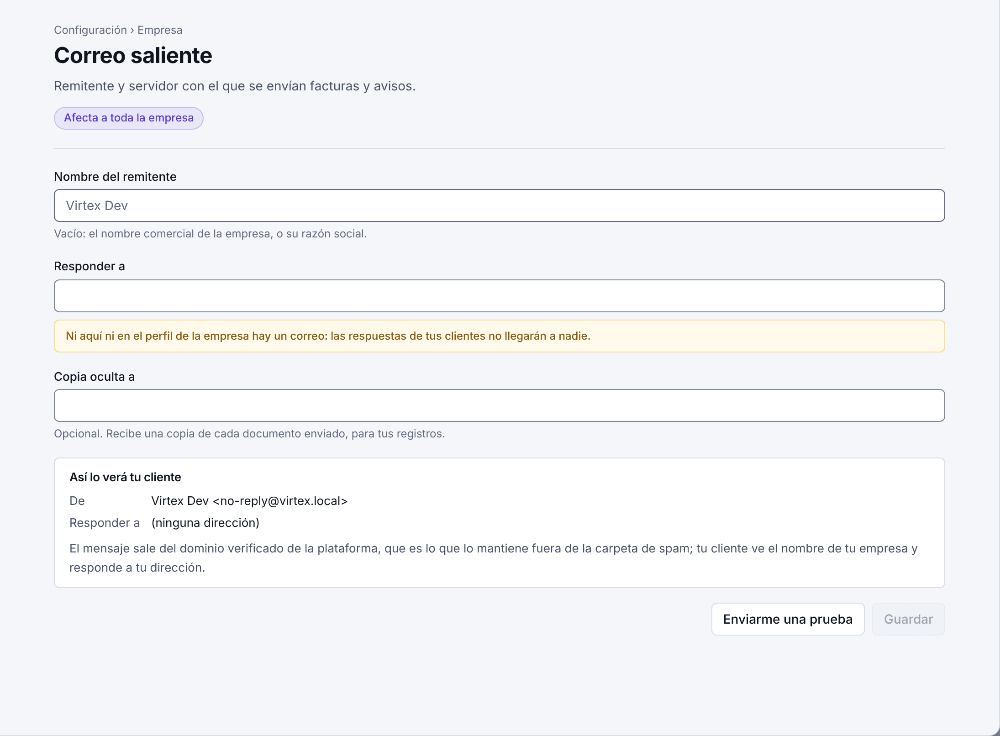

#### H02 · Texto de acento ilegible en tema oscuro
**Regla:** A11Y-01 (DEBE) · **Severidad:** alta · **Páginas:** Mi perfil, Marca de la empresa

- **Mi perfil.** La insignia «ADMINISTRADOR» (1) tiene un contraste de **2,18:1**, cuando el mínimo es 4,5:1. Los botones «Cambiar correo» y «Verificar» (2) tampoco llegan al mínimo (axe: `color-contrast`, 3 elementos).
- **Marca de la empresa.** En la vista previa, «Tu logo» tiene **2,71:1** y «Panel» tampoco llega al mínimo.
- **Causa.** El color del texto es el relleno del acento (`#6a47e8`). El sistema tiene un token propio para el texto de acento, que se ajusta para contrastar.
- **Corrección.** Usar el token de texto de acento, no el de relleno.

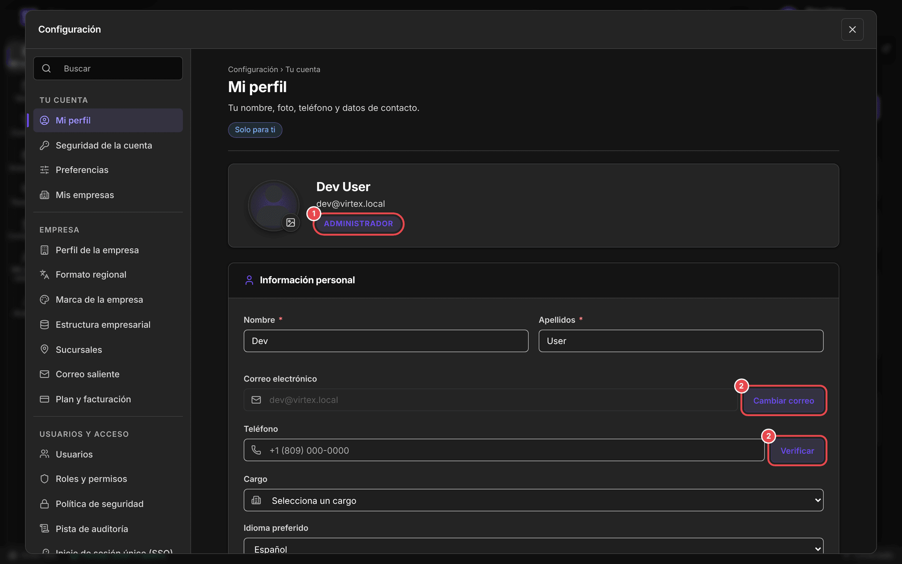
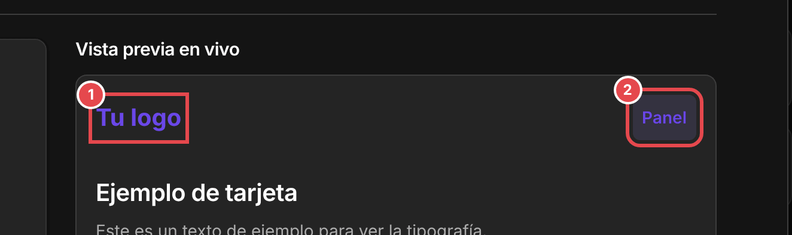

#### H03 · Usuarios: controles sin nombre accesible
**Regla:** A11Y-02 (DEBE) · **Severidad:** alta · **Página:** Usuarios

- **Qué pasa.** Cuatro controles no tienen nombre ni etiqueta: el botón de actualizar (1), la casilla «seleccionar todos» (2), la casilla de cada fila (3) y el botón «…» de acciones (4). axe los marca como críticos (`button-name` y `label`) en tema claro, oscuro y compacto. Un lector de pantalla anuncia «botón» sin decir qué hace.
- **Corrección.** Añadir un `aria-label` a cada uno: «Actualizar», «Seleccionar todos», «Seleccionar Dev User» y «Acciones de Dev User».

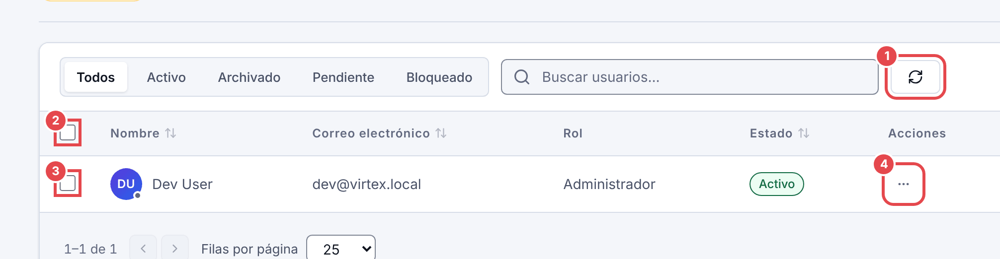

#### H04 · El foco cae donde no se ve
**Regla:** A11Y-03 (DEBE); también A11Y-02 · **Severidad:** alta · **Páginas:** Seguridad de la cuenta, Mi perfil, Marca de la empresa

- **Seguridad de la cuenta (a).** Un campo de texto con `autocomplete="username"`, de 26 × 4 px y opacidad 0, recibe el foco del tabulador y no tiene etiqueta (axe: `label`, crítico). Quien navega con teclado cae en un campo que no ve.
- **Mi perfil (b) y Marca (c).** El campo de archivo oculto recibe el foco, pero ni el botón de la foto ni «Subir logo» lo muestran.
- **Así sí (d).** Comprobantes fiscales usa el control de archivo nativo, y el foco se ve.
- **Corrección.**
  - (a) Poner `tabindex="-1"` y `aria-hidden="true"` en el campo para gestores de contraseñas.
  - (b, c) Reflejar el foco del campo oculto en su botón (`:focus-within` o `:has(input:focus-visible)`).

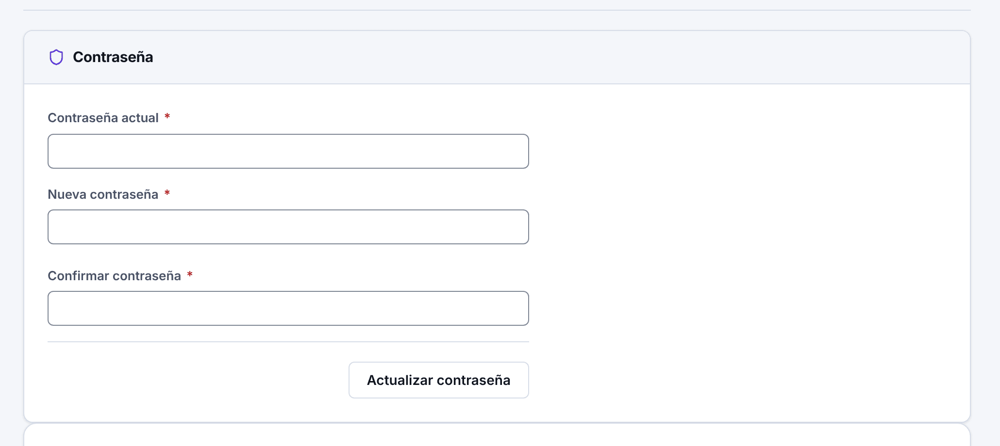

| Foto de perfil, con el foco en el campo | Logo, con el foco en el campo | Así sí: certificado |
|---|---|---|
|  | 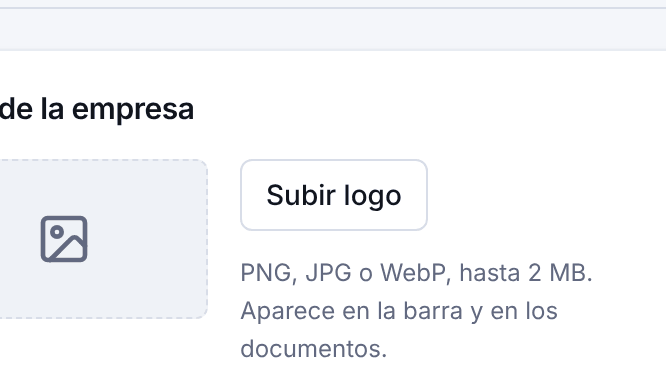 | 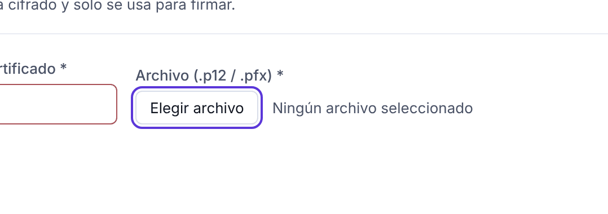 |

### Medios

#### H05 · Inteligencia artificial: el autoguardado no guarda si se cierra con Escape
**Regla:** GUA-01 (DEBE) · **Severidad:** media · **Página:** Inteligencia artificial

- **Qué pasa.** La página dice «Los cambios se guardan solos», pero solo guarda al salir del campo:
  - durante 4 s escribiendo no hubo ninguna petición;
  - al salir del campo llegó `PUT /api/v1/ai/settings`.

  Escribí un presupuesto de 1234 y cerré con Escape: al reabrir seguía en 200, sin ningún aviso.
- **Por qué media y no alta.** Solo ocurre si se cierra sin salir antes del campo.
- **Corrección.** Guardar tras una espera corta en cada cambio, o guardar al cerrar.

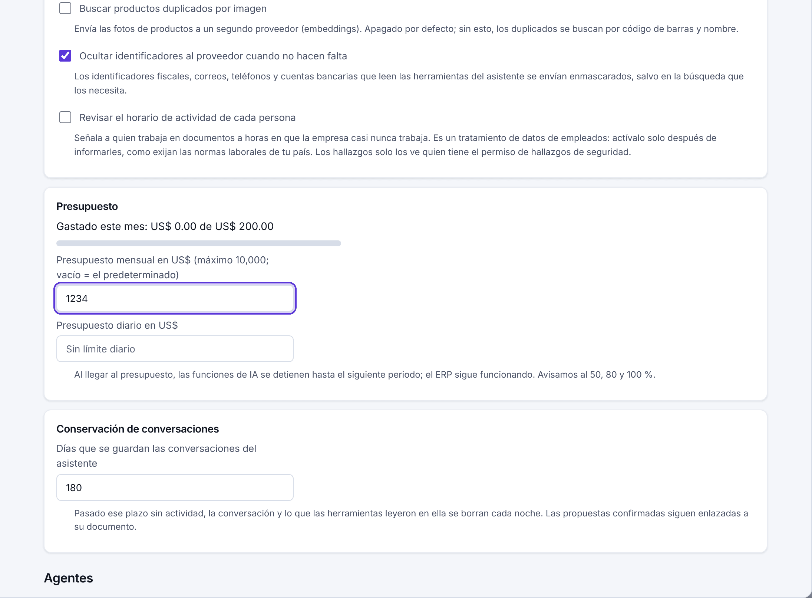
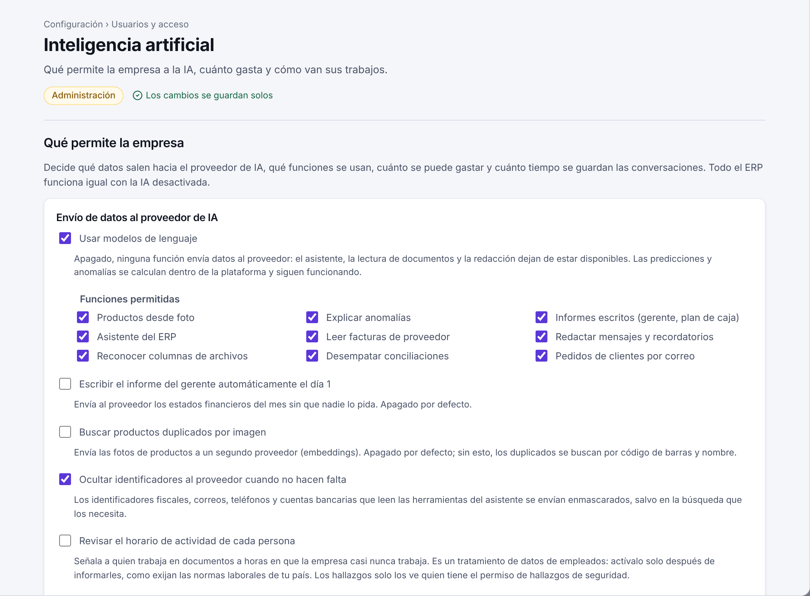

#### H06 · Más de una acción primaria a la vez
**Regla:** ACC-01 (DEBE) · **Severidad:** media · **Páginas:** Seguridad de la cuenta, Comprobantes fiscales; duplicadas en Estructura empresarial, Sucursales, Retenciones y Aprobaciones

- **Seguridad de la cuenta.** «Activar» y «Agregar llave de acceso» son primarias. En cambio, «Actualizar contraseña», que es el envío del formulario principal, es secundaria.
- **Comprobantes fiscales.** «Registrar rango» y «Subir certificado» son primarias.
- **Acción duplicada.** En las otras cuatro páginas la misma acción aparece dos veces como primaria, en la cabecera y en el estado vacío. Es severidad baja, porque no hay duda sobre cuál es la acción.
- **Corrección.**
  - Una primaria por vista; las acciones de las tarjetas secundarias, como botón secundario.
  - Con la lista vacía, una sola llamada a crear.

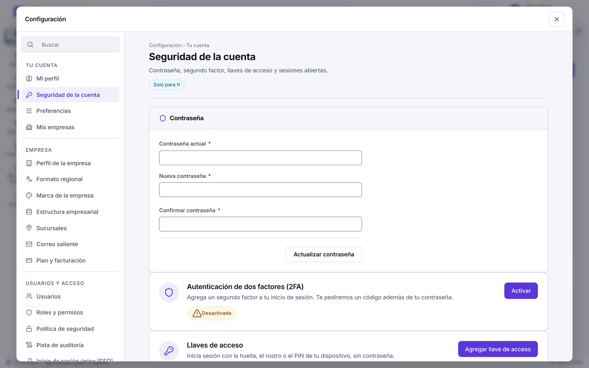
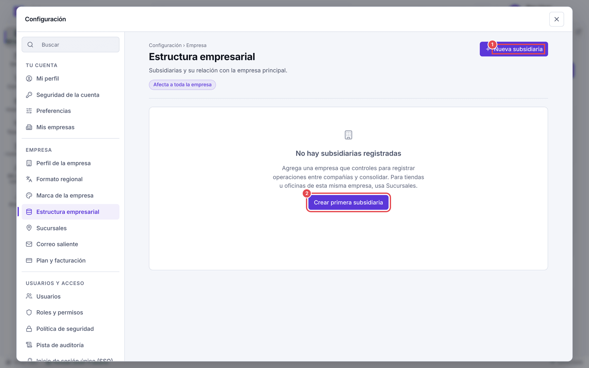

#### H07 · Títulos de grupo: seis estilos para el mismo papel y jerarquía invertida
**Reglas:** TIP-01, JER-02 (DEBE) · **Severidad:** media

El título de grupo dentro de una página cambia de estilo según la página:

| Estilo (px / peso) | Páginas |
|---|---|
| 13 / 600 | Correo saliente, Integraciones («Correo entrante») |
| 14 / 600 | Extensiones; subgrupos de Cuentas predeterminadas y Políticas contables |
| 15 / 600 | Preferencias, Marca, Política de seguridad, Integraciones, Comprobantes fiscales, Retenciones |
| 15 / 700 | Mi perfil, Seguridad de la cuenta («Contraseña»), Perfil de la empresa, SSO |
| 17 / 600 | Seguridad de la cuenta (h3), grupos de Cuentas predeterminadas y Políticas contables, IA |
| 17 / 700 | Plan y facturación |

Además, la jerarquía de encabezados no coincide con la visual:
- **Seguridad de la cuenta.** «Contraseña» es un h2 de 15 px y «Autenticación de dos factores» un h3 de 17 px: el subnivel es más grande (1 frente a 2).
- **Cuentas predeterminadas y Políticas contables.** Grupo y subgrupo son ambos h2, de 17 y 14 px.
- **Mi perfil.** El nombre «Dev User» es un segundo h1.

**Corrección.** Dos estilos fijos, uno para grupo (h2) y otro para subgrupo (h3), desde un mixin común.

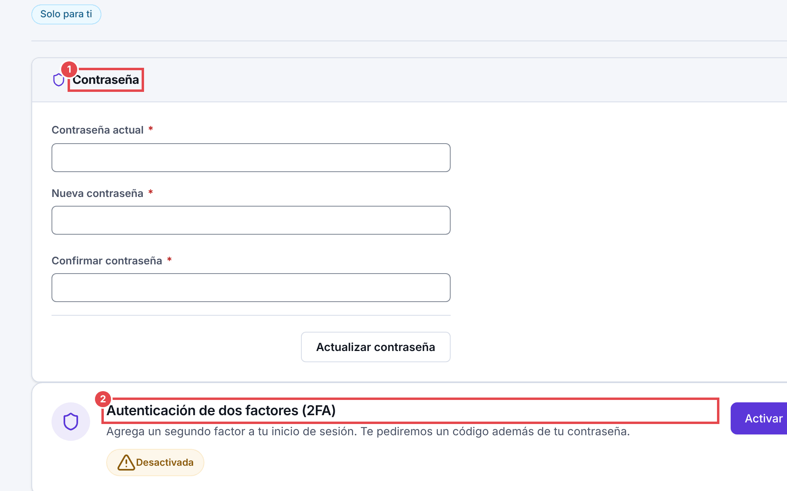
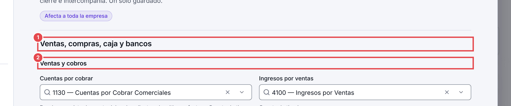
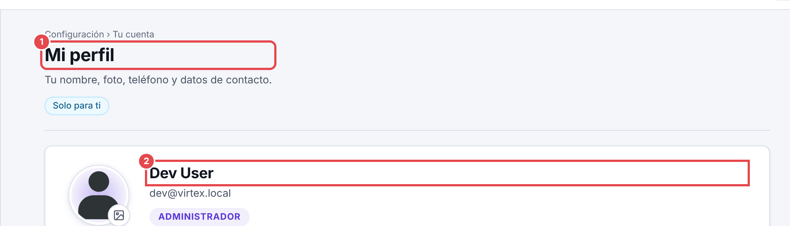

#### H08 · Contenedores: cuatro tipos de tarjeta, con sombras y radios distintos
**Reglas:** CON-02, SOM-01, RAD-01 (DEBE); CON-01 (DEBERÍA) · **Severidad:** media

- **Uso de tarjetas.** 22 de las 25 páginas usan contenedores tipo tarjeta, contando tablas y vistas previas. Los que agrupan contenido usan cuatro cabeceras distintas (abajo, de izquierda a derecha y de arriba abajo).
- **Sombras.** 17 páginas ponen sombra a tarjetas de contenido. La constitución la reserva a las capas flotantes.
- **Radios.** Hay radios de 6, 9,6 y 13,8 px.
- **Anidamiento.** Hay tarjetas dentro de tarjetas en Preferencias, Marca e IA.
- **Uso innecesario.** En 11 páginas la tarjeta no separa una unidad independiente: parte un mismo formulario o envuelve un estado vacío.
- **Corrección.** Una anatomía de grupo (título y espacio), y tarjeta solo para unidades independientes.

> SOM-01 depende de una decisión pendiente (D1): hoy el sistema de diseño da sombra a las tarjetas (`ds.surface-card`) y la constitución la prohíbe. Se evaluó con la constitución.

| Banda gris con icono (Mi perfil) | Banda gris con subtítulo (Perfil de la empresa) |
|---|---|
| 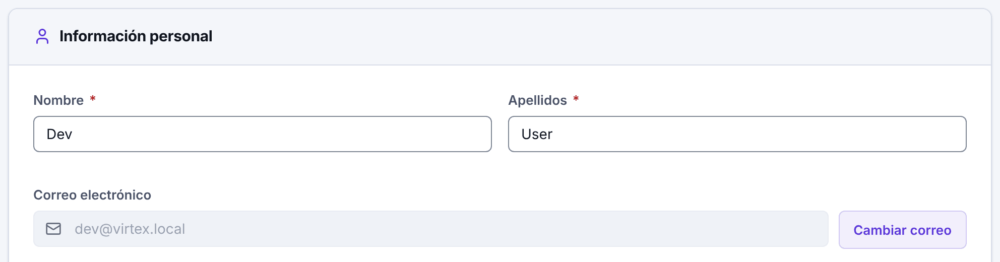 | 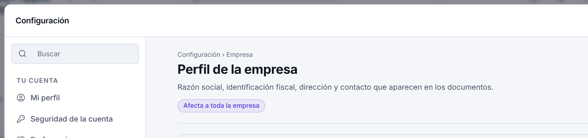 |
| **Icono circular a la izquierda (Seguridad de la cuenta)** | **Cabecera en mayúsculas con icono (Plan y facturación)** |
|  | 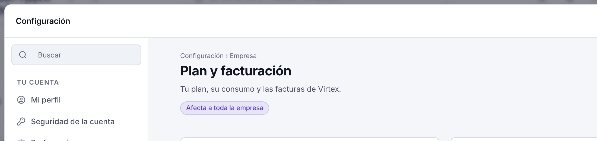 |

#### H09 · Cuatro modelos de guardado
**Regla:** GUA-02 (DEBERÍA) · **Severidad:** media

| Modelo | Páginas |
|---|---|
| Barra fija que aparece con cambios y pregunta al salir | Mi perfil, Perfil de la empresa, Formato regional, Marca, Numeración, Cuentas predeterminadas, Políticas contables |
| Botón «Guardar» al pie, sin protección | Correo saliente (H01) |
| Autoguardado al salir del campo | Preferencias, Inteligencia artificial (H05) |
| Aplicación inmediata con confirmación | Política de seguridad, Seguridad de la cuenta |

La persona tiene que descubrir en cada página cómo se guarda (comparar P01 con H01-a).

**Corrección.** Barra fija para los formularios; autoguardado solo para las preferencias personales, y siempre indicado.

#### H10 · Cuatro patrones de estado vacío
**Regla:** EST-01 (DEBE) · **Severidad:** media

- **Los cuatro patrones.**
  - El componente común, con icono, título, texto y acción (Estructura empresarial, Sucursales).
  - El mismo, pero dentro de una tarjeta (Retenciones, Aprobaciones).
  - Texto plano centrado (Pista de auditoría; dominios de SSO; Comprobantes fiscales).
  - Icono y texto sin título (Extensiones).
- **Dos patrones en una página.** SSO muestra dos patrones distintos en la misma página (1 y 2).
- **Pista de auditoría.** En una empresa nueva dice «No hay registros con estos filtros» porque el filtro por defecto oculta las acciones del sistema, y no ofrece quitarlo.
- **Corrección.** El componente común, sin tarjeta, en todas. En la pista, una acción «Mostrar también las del sistema».

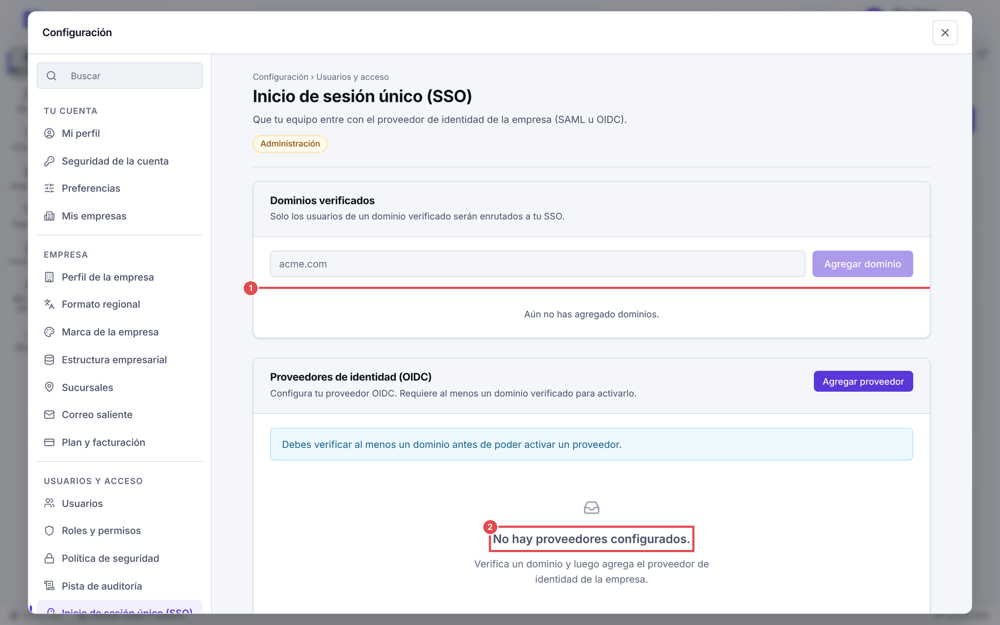

| Texto plano (Pista de auditoría) | Sin título (Extensiones) |
|---|---|
| 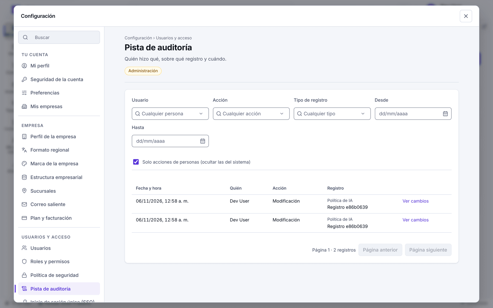 | 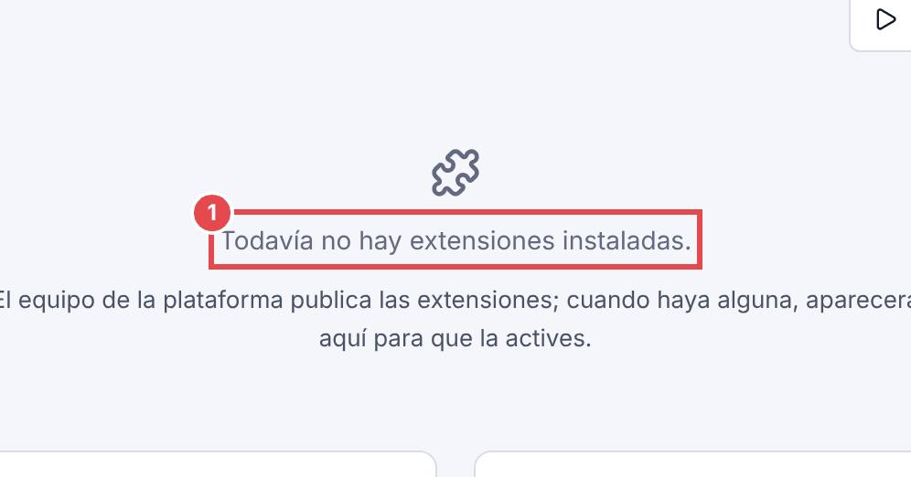 |

#### H11 · El mismo estado, distinto color
**Regla:** COL-01 (DEBE) · **Severidad:** media

- **Estado activo.** En Integraciones, «Activa» es una etiqueta neutra con borde negro. En Usuarios, «Activo» es verde, igual que «Activa · Se renueva…» en Plan y facturación.
- **Avisos bloqueantes.** En Comprobantes fiscales, «Todavía no puedes emitir comprobantes» va en una caja gris con título naranja. En Correo saliente, el aviso equivalente va en una banda amarilla.
- **Corrección.** Tono según el significado, siempre desde `vx-badge` y un único componente de aviso.

| «Activa» neutro (Integraciones) | «Activo» verde (Usuarios) |
|---|---|
| 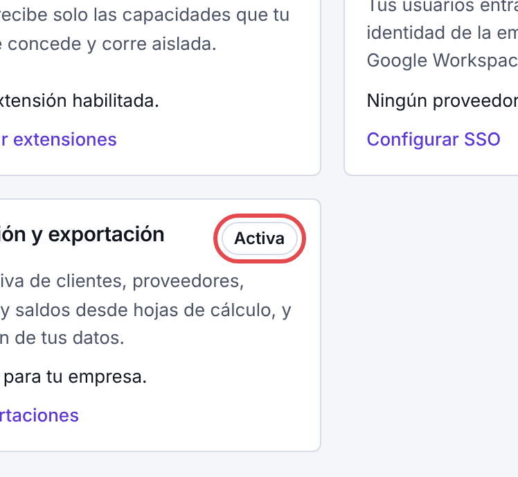 | 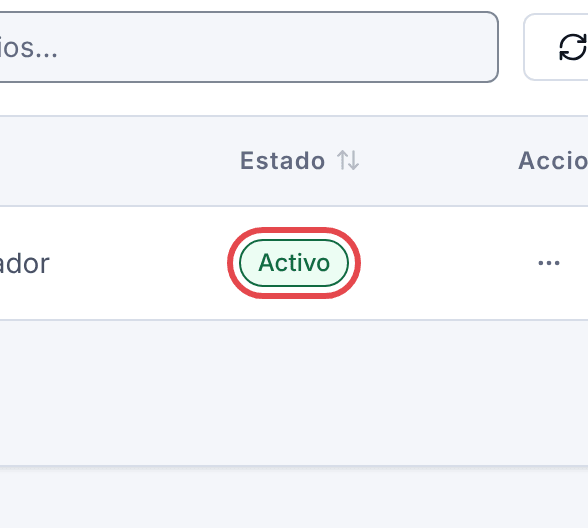 |
| **Aviso bloqueante gris (Comprobantes fiscales)** | **Aviso amarillo (Correo saliente)** |
| 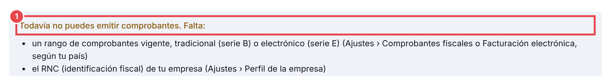 | 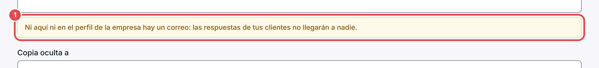 |

#### H12 · Clave de traducción a la vista
**Regla:** CONT-01 (DEBE) · **Severidad:** media · **Página:** Inteligencia artificial

- **Qué pasa.** La página muestra `[[ai.admin.state.engine_offline]]` (dos veces) junto a «El servidor no tiene configurado el proveedor de IA». La consola registra la traducción que falta.
- **Corrección.** Añadir la clave a los catálogos de es, en y pt.

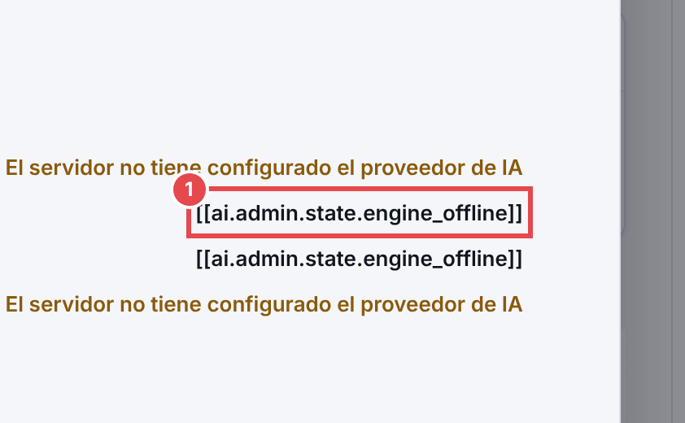

#### H13 · Textos que se contradicen o se repiten
**Regla:** CONT-02 (DEBE) · **Severidad:** media · **Páginas:** Preferencias, Política de seguridad, Aprobaciones, Numeración, SSO

- **Preferencias se contradice.** La banda superior dice que las preferencias se aplican «al instante en este equipo», y la tarjeta de fechas dice «Solo para ti y en todos tus dispositivos» (a, b).
- **Preferencias repite.** Bajo Idioma hay dos ayudas casi iguales (c).
- **Política de seguridad** explica lo mismo dos veces (d).
- **Aprobaciones** repite en el cuerpo del estado vacío lo que dice su título (e).
- **Numeración y SSO** repiten, en el pie o en el estado vacío, lo que ya dicen la descripción o la banda.
- **Corrección.** Decir una sola vez qué se guarda en el equipo y qué en la cuenta, y quitar los duplicados.

| «En este equipo» | «En todos tus dispositivos» |
|---|---|
| 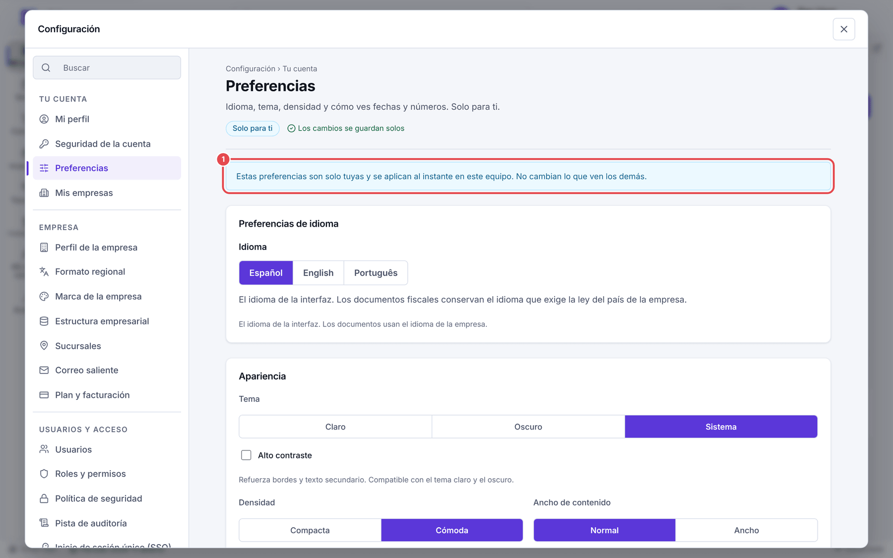 | 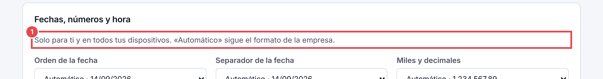 |

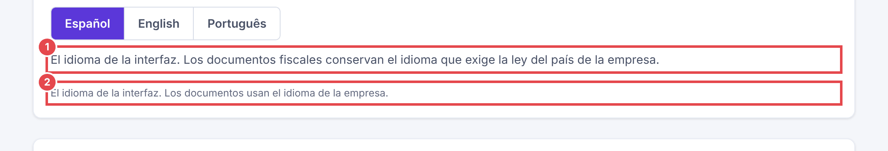
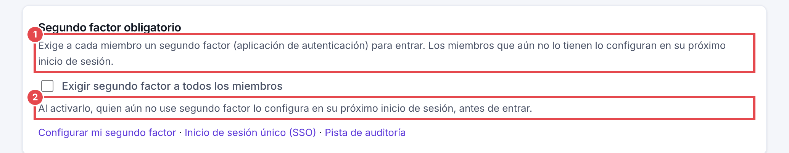
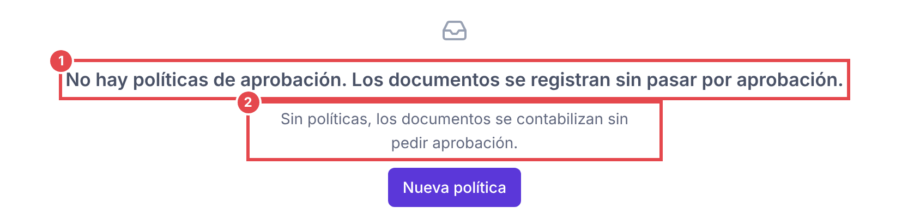

#### H14 · «Ajustes» en una modal que se llama «Configuración»
**Regla:** CONT-03 (DEBE) · **Severidad:** media · **Página:** Comprobantes fiscales

- **Qué pasa.** El aviso remite a «Ajustes › Comprobantes fiscales o Facturación electrónica, según tu país» y a «Ajustes › Perfil de la empresa». Tiene cuatro problemas:
  - el área se llama «Configuración», no «Ajustes»;
  - la primera ruta es la propia página;
  - el texto es genérico aunque el país (DO) se conoce;
  - no hay enlaces.
- **Corrección.** Usar los nombres reales y enlazar directamente.

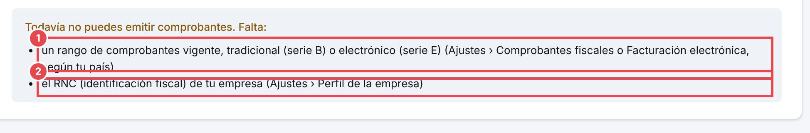

#### H15 · Patrones distintos para la misma función
**Regla:** COMP-01 (DEBE) · **Severidad:** media

| Función | Variantes |
|---|---|
| Acciones de fila | Menú «…» en Usuarios; iconos en línea en Roles |
| Subir archivo | Botón «Subir logo» (Marca); icono sobre el avatar (Mi perfil); control nativo «Elegir archivo» (Comprobantes fiscales); ver H04 |
| Control segmentado | Idioma a la medida del texto; Tema a todo el ancho; Densidad y Ancho a media columna (Preferencias) |
| Desplegable | «▾» en Sesiones activas; «▶» en Retenciones |

**Corrección.** Un componente por función.

| Iconos en línea (Roles) | Menú de fila (Usuarios) |
|---|---|
| 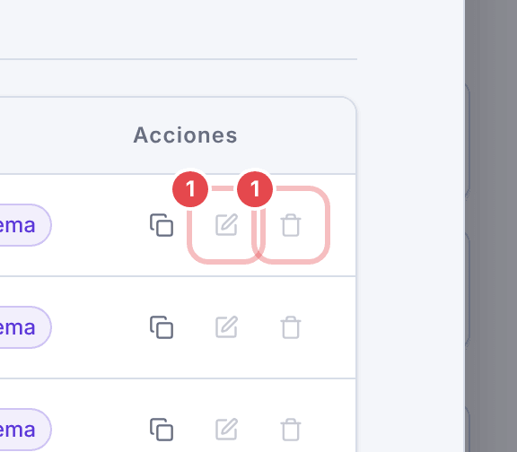 | 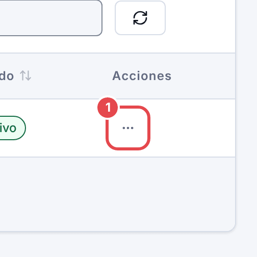 |

#### H16 · En móvil, Usuarios y Roles pierden columnas
**Regla:** RESP-01 (DEBE) · **Severidad:** media

- **Usuarios.** A 390 px la tabla corta la columna de correo y deja Rol, Estado y Acciones detrás de un desplazamiento horizontal que nada anuncia. Las pestañas de estado quedan recortadas y «Bloqueado» no se ve.
- **Roles.** Su tabla necesita 549 px en un espacio de 358.
- **El resto.** Las demás páginas se adaptan sin desbordar.
- **Corrección.** En modo compacto, mostrar una lista con nombre, estado y menú de acciones, y convertir las pestañas en un selector.

| Usuarios a 390 px | Roles a 390 px |
|---|---|
| 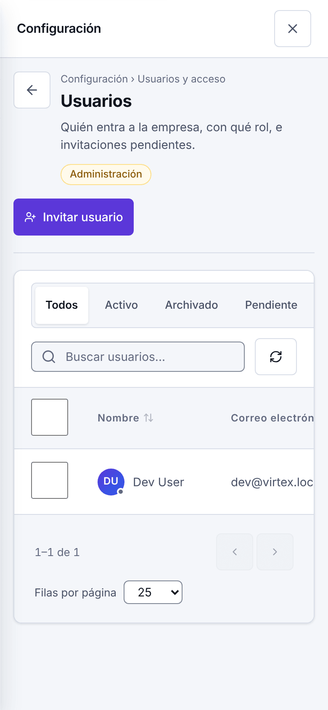 | 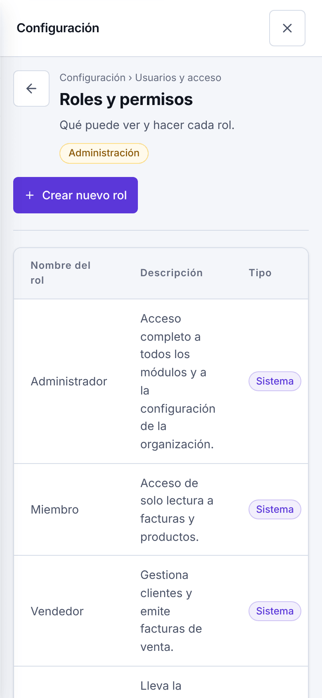 |

### Bajos

#### H17 · Tarjetas pegadas
**Regla:** ESP-01 · **Páginas:** Seguridad de la cuenta, Perfil de la empresa

La separación medida entre tarjetas es de **0 px** en estas dos páginas; en Mi perfil es de 24 px.

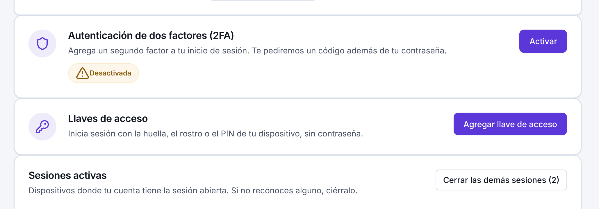

#### H18 · Alineación y agrupación
**Regla:** ALI-01

- **Seguridad de la cuenta.** «3 sesiones en este dispositivo ▾» empieza en el borde de la tarjeta, fuera de su margen interior.
- **Inteligencia artificial.** Las ayudas bajo los campos de presupuesto están sangradas respecto de su campo.
- **Pista de auditoría.** «Hasta» queda sola en otra fila, separada de «Desde».

| Enlace fuera del margen | «Desde» y «Hasta» separados |
|---|---|
| 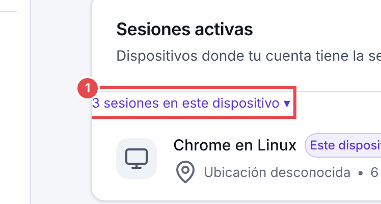 | 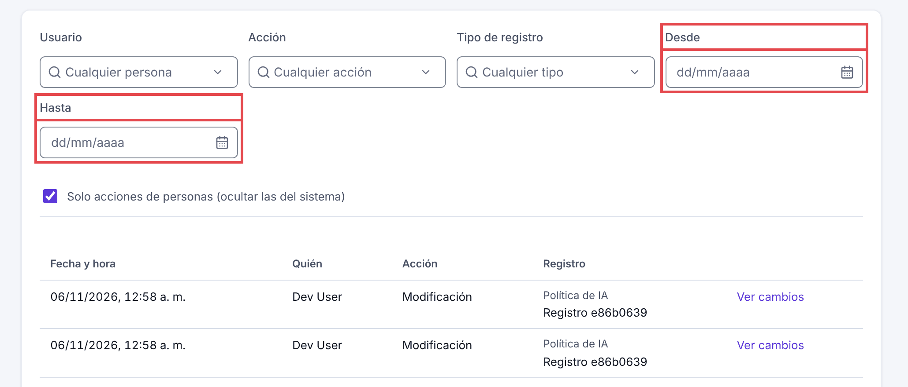 |

#### H19 · Controles de muestra que parecen reales
**Regla:** ACC-02 (severidad bajada a baja: es una vista previa)

- **Qué pasa.** La vista previa de Marca tiene los botones «Cancelar» y «Aceptar» y un «Campo de ejemplo» que se pueden enfocar con teclado. No hacen nada, y el campo no muestra el foco.
- **Corrección.** Marcar la vista previa como inerte (`inert`).

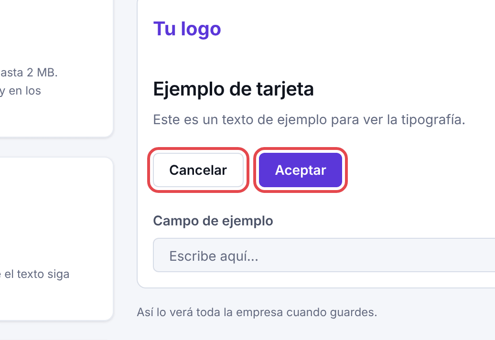

#### H20 · Acciones fuera de la cabecera
**Regla:** ACC-03

Extensiones pone «Abrir ejecución» y «Actualizar» en el contenido. Las demás páginas ponen sus acciones en la cabecera.

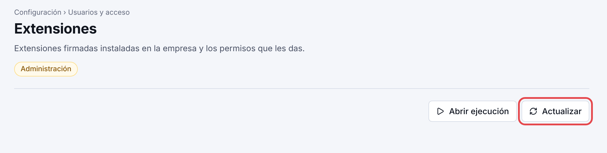

#### H21 · Moneda en tres formatos
**Regla:** FMT-01

- **Qué pasa.** La misma clase de dato aparece de tres formas:
  - «US$ 0.00 de US$ 200.00» en IA, con espacio y decimales;
  - «US$199/mes» en Plan, sin espacio ni decimales;
  - «RD$1,234,567.89» en la vista previa de formato.
- **Corrección.** Un único formateador.

| IA | Plan y facturación |
|---|---|
| 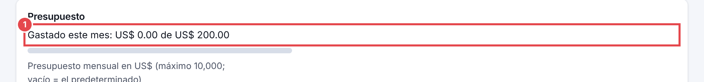 | 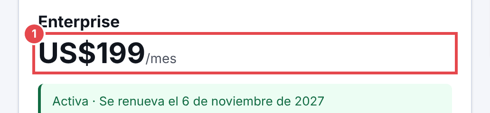 |

#### H22 · Mayúsculas, minúsculas y cifras
**Reglas:** TIP-02, CONT-04, TIP-03

- **Mayúsculas sostenidas.** «PLAN ACTUAL» y «MÉTODO DE PAGO» en Plan y facturación, y la insignia «ADMINISTRADOR» en Mi perfil.
- **Minúsculas incoherentes.** La lista de consumo escribe «facturas, usuarios, clientes…» en minúscula, pero «Créditos de IA» con mayúscula.
- **Cifras.** Las cifras de esa lista, alineadas a la derecha, no usan numerales tabulares (`font-variant-numeric: normal`).

| Mayúsculas sostenidas | Minúsculas y cifras de la lista de consumo |
|---|---|
| 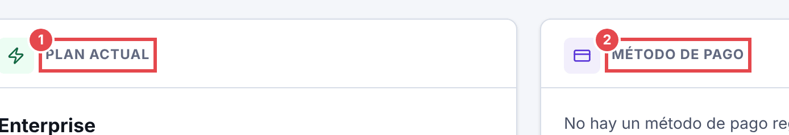 | 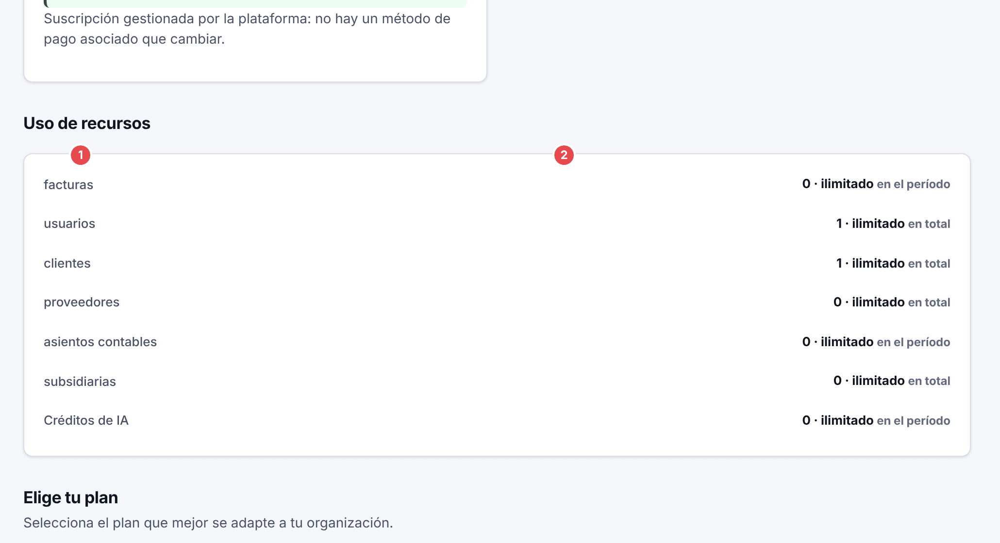 |

#### H23 · Formularios: asterisco, etiquetas y anchos
**Reglas:** FORM-01, FORM-02

- **Asterisco.** El marcador de obligatorio es rojo en Mi perfil y del color de la etiqueta en Comprobantes fiscales.
- **Etiquetas.** SSO («acme.com») y Extensiones («nombre de la extensión») usan el texto de ejemplo como única etiqueta.
- **Anchos.** Teléfono, Cargo y Nombre del remitente ocupan todo el ancho (entre 830 y 976 px) para datos cortos.

| Asterisco rojo (Mi perfil) | Asterisco del color de la etiqueta (Comprobantes fiscales) |
|---|---|
|  |  |

#### H24 · «Agregar dominio» deshabilitado sin motivo
**Regla:** COMP-02 (severidad bajada a baja: el motivo es casi evidente)

En SSO, el botón está deshabilitado mientras el campo está vacío y nada lo dice. Se ve en la captura de H10-a.

#### H25 · Buscador: términos habituales con resultado incompleto
**Regla:** NAV-01

- **Qué pasa.** «firma» solo encuentra Extensiones, no Comprobantes fiscales, donde está el certificado digital de firma. «impuestos» solo encuentra Cuentas predeterminadas, no Retenciones ni Comprobantes fiscales.
- **El resto.** Las otras 11 búsquedas dieron el resultado esperado. «zona horaria» y «xyz123», sin resultados, también son correctas: esa configuración no existe.

#### H26 · Integraciones e IA: rejilla 3 + 1, accesos duplicados y operación dentro de Configuración
**Reglas:** ANT-01, ARQ-01

- **Rejilla.** Integraciones muestra tres tarjetas y una huérfana. La constitución lista las rejillas repetitivas de tres columnas entre los antipatrones.
- **Accesos duplicados.** Tres de sus cuatro tarjetas llevan a páginas que ya están en la barra lateral.
- **Operación en Configuración.** IA ocupa 2,9 pantallas porque mezcla la política con bitácoras y propuestas del asistente, que son operación, no configuración.

---

## Estándar v0.1 aplicado

Reglas derivadas de la constitución de diseño y de lo acordado en la conversación previa.

**Fuerza de las reglas.**
- **DEBE:** se cumple literalmente.
- **DEBERÍA:** apartarse exige una justificación escrita.

**Severidad.** La que figura es la severidad por defecto. Si un hallazgo la cambia, lo dice y explica por qué.

**Verificación.**
- **DOM:** medición de estilos y estructura.
- **axe:** axe-core con WCAG 2.2 AA.
- **Teclado:** recorrido con tabulador.
- **Prueba:** interacción con cambios.
- **Criterio:** pregunta concreta.

| ID | Fuerza | Regla | Verificación | Severidad |
|---|---|---|---|---|
| JER-01 | DEBE | Toda página tiene la cabecera común: miga, título, descripción y alcance | DOM | media |
| JER-02 | DEBE | Un h1 por vista; el nivel del encabezado sigue la jerarquía visual (un subnivel nunca es más grande) | DOM | media |
| TIP-01 | DEBE | Un papel tipográfico (título de grupo, subtítulo, etiqueta, ayuda) tiene un solo estilo en toda la modal | DOM | media |
| TIP-02 | DEBERÍA | Sin mayúsculas sostenidas, salvo la etiqueta de grupo de la barra lateral | DOM | baja |
| TIP-03 | DEBE | Las cifras alineadas en columna usan numerales tabulares | DOM | baja |
| ACC-01 | DEBE | Como máximo una acción primaria habilitada visible a la vez por vista | Observación | media |
| ACC-02 | DEBE | Ningún control visible sin acción real; las muestras son inertes | Observación, teclado | media |
| ACC-03 | DEBERÍA | Las acciones de la página van en su cabecera | Observación | baja |
| ACC-04 | DEBE | Las acciones destructivas o de alcance amplio piden confirmación proporcional | Prueba | alta |
| GUA-01 | DEBE | Ningún cambio se pierde sin aviso: Escape, la X, el fondo y el cambio de página preguntan | Prueba | alta |
| GUA-02 | DEBERÍA | Un solo modelo de guardado para los formularios de configuración | Observación | media |
| GUA-03 | DEBE | Si no se puede guardar, se dice por qué | Prueba | media |
| CON-01 | DEBERÍA | Agrupar con título y espacio; tarjeta solo para unidades independientes; nunca una dentro de otra | Criterio: «¿qué se pierde si fuera título y espacio?» | baja |
| CON-02 | DEBE | Una sola anatomía de contenedor de grupo | DOM, observación | media |
| SOM-01 | DEBE | Sombra solo en capas flotantes (menús, diálogos, avisos) | DOM | baja |
| RAD-01 | DEBE | Un radio por tipo de componente | DOM | baja |
| ESP-01 | DEBE | Un único escalón de separación entre grupos | DOM | baja |
| ALI-01 | DEBE | Lo relacionado, junto; alineado con el margen interior; la ayuda alineada con su campo | Observación | baja |
| COL-01 | DEBE | Mismo significado, mismo color (estados, avisos) | Observación | media |
| COL-02 | DEBE | Ningún estado depende solo del color | Observación | alta |
| EST-01 | DEBE | Una sola anatomía de estado vacío: icono, título, explicación y acción cuando la haya | Observación | media |
| EST-02 | DEBE | Cada página muestra carga y error con reintento | Prueba | media |
| CONT-01 | DEBE | Ningún texto aparece como clave de traducción | DOM, consola | media |
| CONT-02 | DEBE | Una página no se contradice ni repite la misma explicación | Lectura | media |
| CONT-03 | DEBE | Los lugares del producto se nombran como se llaman y se enlazan | Lectura | media |
| CONT-04 | DEBERÍA | Mayúscula inicial consistente (estilo oración) | Lectura | baja |
| FMT-01 | DEBE | Un formato por tipo de dato (fecha, moneda) en toda la modal | DOM | baja |
| FORM-01 | DEBE | Todo campo tiene etiqueta visible; un único estilo de marcador de obligatorio | DOM, axe | baja |
| FORM-02 | DEBERÍA | El ancho del campo corresponde al dato que recibe | Criterio | baja |
| COMP-01 | DEBE | Un patrón por función (acciones de fila, subida de archivos, segmentados, desplegables) | Observación | media |
| COMP-02 | DEBE | Un control deshabilitado explica por qué, de forma accesible | Teclado, DOM | media |
| A11Y-01 | DEBE | Contraste AA (4,5:1 en texto) en tema claro y oscuro | axe | alta |
| A11Y-02 | DEBE | Todo control tiene nombre accesible y toda casilla, etiqueta | axe | alta |
| A11Y-03 | DEBE | El foco siempre se ve y nunca cae en un elemento invisible | Teclado y captura | alta |
| A11Y-04 | DEBE | El foco no sale de la modal | Teclado | alta |
| A11Y-05 | DEBE | Objetivos de al menos 24 × 24 px (WCAG 2.5.8), también en densidad compacta | axe | media |
| A11Y-06 | DEBE | Escape cierra solo la capa superior | Teclado | media |
| NAV-01 | DEBERÍA | El buscador lleva a cada página por sus términos habituales | Prueba | baja |
| NAV-02 | DEBE | La ubicación se ve: página activa marcada y miga | DOM | media |
| ARQ-01 | DEBERÍA | Cada ajuste vive en un solo sitio; la modal contiene configuración, no operación | Criterio | baja |
| RESP-01 | DEBE | En modo compacto (menos de 900 px) ninguna página pierde información ni acciones | Observación | media |
| ANT-01 | DEBE | Ningún antipatrón de la §10 de la constitución | Observación | baja |
| PERM-01 | DEBE | Sin permiso de edición, la página se ve en solo lectura y dice qué permiso falta | Prueba | media |

## Veredicto por regla

Ámbito **global**: la regla se evalúa una vez para toda la modal y vale 1 o 0. Ámbito **local**: la puntuación es la proporción de páginas aplicables que cumplen.

| ID | Fuerza | Ámbito | Puntuación | Resultado | Dónde falla / evidencia |
|---|---|---|---|---|---|
| JER-01 | DEBE | global | 1,00 | Cumple | Cabecera común en las 25 páginas |
| JER-02 | DEBE | local | 0,80 | Cumple en 20 de 25 | Mi perfil, Seguridad de la cuenta, Cuentas predeterminadas, Políticas contables, Integraciones |
| TIP-01 | DEBE | global | 0,00 | No cumple | Seis estilos para el título de grupo (H07) |
| TIP-02 | DEBERÍA | local | 0,92 | Cumple en 23 de 25 | Mi perfil, Plan y facturación (H22) |
| TIP-03 | DEBE | local | 0,50 | Cumple en 1 de 2 | Plan y facturación (H22) |
| ACC-01 | DEBE | local | 0,76 | Cumple en 19 de 25 | Seguridad de la cuenta, Comprobantes fiscales; duplicadas en cuatro (H06) |
| ACC-02 | DEBE | local | 0,96 | Cumple en 24 de 25 | Marca de la empresa (H19) |
| ACC-03 | DEBERÍA | local | 0,96 | Cumple en 24 de 25 | Extensiones (H20) |
| ACC-04 | DEBE | global | 1,00 | Cumple | Restablecer marca, cerrar sesiones, exigir 2FA |
| GUA-01 | DEBE | local | 0,80 | Cumple en 8 de 10 | Correo saliente (H01), Inteligencia artificial (H05) |
| GUA-02 | DEBERÍA | global | 0,00 | No cumple | Cuatro modelos de guardado (H09) |
| GUA-03 | DEBE | global | 1,00 | Cumple | La barra dice por qué no se puede guardar (P01) |
| CON-01 | DEBERÍA | local | 0,56 | Cumple en 14 de 25 | 11 páginas con tarjetas innecesarias o anidadas (H08) |
| CON-02 | DEBE | global | 0,00 | No cumple | Cuatro anatomías de tarjeta (H08) |
| SOM-01 | DEBE | local | 0,32 | Cumple en 8 de 25 | 17 páginas con sombra en el contenido (H08; depende de D1) |
| RAD-01 | DEBE | global | 0,00 | No cumple | Radios de 6, 9,6 y 13,8 px en tarjetas (H08) |
| ESP-01 | DEBE | local | 0,92 | Cumple en 23 de 25 | 0 px entre tarjetas (H17) |
| ALI-01 | DEBE | local | 0,88 | Cumple en 22 de 25 | Seguridad de la cuenta, IA, Pista de auditoría (H18) |
| COL-01 | DEBE | global | 0,00 | No cumple | «Activa» neutro frente a verde; avisos gris frente a amarillo (H11) |
| COL-02 | DEBE | global | 1,00 | Cumple | Todo estado lleva texto |
| EST-01 | DEBE | global | 0,00 | No cumple | Cuatro patrones de estado vacío (H10) |
| EST-02 | DEBE | global | — | No verificable | No se simularon fallos de red |
| CONT-01 | DEBE | local | 0,96 | Cumple en 24 de 25 | Inteligencia artificial (H12) |
| CONT-02 | DEBE | local | 0,80 | Cumple en 20 de 25 | Preferencias, Política de seguridad, Aprobaciones, Numeración, SSO (H13) |
| CONT-03 | DEBE | local | 0,96 | Cumple en 24 de 25 | Comprobantes fiscales (H14) |
| CONT-04 | DEBERÍA | local | 0,96 | Cumple en 24 de 25 | Plan y facturación (H22) |
| FMT-01 | DEBE | global | 0,00 | No cumple | Moneda en tres formatos (H21) |
| FORM-01 | DEBE | local | 0,79 | Cumple en 11 de 14 | Comprobantes fiscales, SSO, Extensiones (H23) |
| FORM-02 | DEBERÍA | local | 0,83 | Cumple en 10 de 12 | Mi perfil, Correo saliente (H23) |
| COMP-01 | DEBE | global | 0,00 | No cumple | Acciones de fila, subida de archivos, segmentados y desplegables distintos (H15) |
| COMP-02 | DEBE | local | 0,83 | Cumple en 5 de 6 | SSO (H24) |
| A11Y-01 | DEBE | local | 0,92 | Cumple en 23 de 25 | Mi perfil y Marca, en tema oscuro (H02) |
| A11Y-02 | DEBE | local | 0,92 | Cumple en 23 de 25 | Usuarios, Seguridad de la cuenta (H03, H04) |
| A11Y-03 | DEBE | local | 0,88 | Cumple en 22 de 25 | Seguridad de la cuenta, Mi perfil, Marca (H04) |
| A11Y-04 | DEBE | global | 1,00 | Cumple | 0 fugas de foco en 25 páginas |
| A11Y-05 | DEBE | global | 1,00 | Cumple | axe 2.5.8 sin fallos en ambas densidades |
| A11Y-06 | DEBE | global | 1,00 | Cumple | Escape cierra solo la capa superior |
| NAV-01 | DEBERÍA | global | 0,00 | No cumple | «firma» e «impuestos» no llevan a todas sus páginas (H25) |
| NAV-02 | DEBE | global | 1,00 | Cumple | Página activa marcada y miga |
| ARQ-01 | DEBERÍA | global | 0,00 | No cumple | Integraciones duplica accesos; IA aloja operación (H26) |
| RESP-01 | DEBE | local | 0,92 | Cumple en 23 de 25 | Usuarios, Roles y permisos (H16) |
| ANT-01 | DEBE | local | 0,96 | Cumple en 24 de 25 | Integraciones, rejilla 3 + 1 (H26) |
| PERM-01 | DEBE | global | — | No verificable | El usuario de prueba tiene todos los permisos |

## Cálculo de la nota

Fórmula del protocolo, sin ajustes a ojo (código: [`harness/nota.py`](2026-11-modal-configuracion/harness/nota.py)).

1. **Pesos.** Cada regla pesa según su fuerza: DEBE vale 3 y DEBERÍA vale 1.
2. **Puntos.** Se suma peso × puntuación: 72,87 de 107 → **68,1 %**.
3. **Nota base.** 10 × 68,1 % = **6,81**.
4. **Topes.** Un hallazgo bloqueante limitaría la nota a 4; uno alto, a 7. Hay altos y ninguno bloqueante, así que el tope es 7, que no recorta.
5. **Cobertura.** 41 de 43 reglas evaluadas (95 %). Por encima del 80 % la nota es definitiva, no provisional.

**Nota final: 6,8 / 10.**

**Sobre la agregación por página.** Para un objeto de 25 páginas, las reglas locales puntúan según la proporción de páginas que cumplen. Si bastara una página que falle para dar la regla entera por incumplida, la nota sería **2,2**. Ese cálculo cuenta cuántos tipos de defecto existen, no a cuánto de la modal afectan, y por eso no se usa como nota. La propuesta 1 pide fijar esta regla en el protocolo.

**Qué la mueve.**
- **Las ocho reglas de consistencia global** valen 22 puntos. Corregirlas llevaría la nota a ≈ 8,9.
- **SOM-01.** Si en D1 se decide mantener la sombra de las tarjetas, la regla cambia y la nota pasa a 7,0.
- **Los hallazgos altos.** Corregirlos suma poco por sí solo, pero quita el tope de 7.

## Decisiones pendientes que afectan a esta evaluación

- **D1, sombras.** La constitución prohíbe la sombra en el contenido; `ds.surface-card` la aplica. Se evaluó con la constitución.
- **D5, mayúsculas.** TIP-02 asume que solo la etiqueta de grupo de la barra lateral puede ir en mayúsculas.
- **Fuerza de las reglas.** Todas las reglas son borrador (v0.1) y se aplicaron como vigentes por instrucción expresa. Por eso esta nota no es comparable con evaluaciones hechas con otra versión del estándar.

## Propuestas al estándar surgidas de esta evaluación

1. **Agregación por página.** Fijar en el protocolo la usada aquí: reglas globales binarias y reglas locales por proporción de páginas.
2. **ACC-01.** Aclarar que las primarias deshabilitadas no cuentan, y que la misma acción duplicada sí cuenta, con severidad baja.
3. **CON-01.** Sustituir el criterio por una lista de usos permitidos de la tarjeta: tabla con barra de herramientas, vista previa y unidad independiente.
4. **COMP-02.** Adoptar como canónico el patrón de Roles: `aria-disabled` y el motivo en el nombre accesible.
5. **A11Y-03.** La detección automática de foco dio un falso positivo en la Pista de auditoría, donde el anillo lo pinta un contenedor; se descartó tras verlo en captura. La regla debe exigir esa confirmación visual.
6. **Mecanizables.**
   - GUA-01: una prueba de cierre con cambios en cada página del registro.
   - CONT-01: ninguna traducción que falte en la consola.
   - A11Y-01 y A11Y-02: axe en tema claro y oscuro.
   - TIP-01 y RAD-01: comprobación de estilos computados.

## Reproducibilidad

[`harness/README.md`](2026-11-modal-configuracion/harness/README.md) explica cómo repetir cada paso. Las mediciones en bruto, en JSON, están en [`resultados/`](2026-11-modal-configuracion/resultados/):

| Archivo | Contenido |
|---|---|
| `base.json`, `dark.json`, `laptop.json`, `phone.json`, `density.json` | Mediciones y axe por condición |
| `focus.json` | Recorrido de teclado |
| `search.json` | Buscador |
| `dirty.json`, `dirty2.json`, `ai-autosave.json` | Protección de cambios |
| `evidence-log.json` | Comprobaciones hechas al capturar la evidencia |
